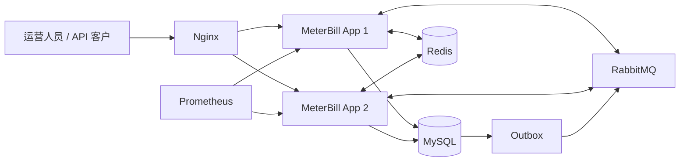

# MeterBill

MeterBill 是一个面向 AI API SaaS 的多租户计量、计费与账务平台。它把“套餐配置 → 客户订阅 → Token 用量上报 → 异步聚合 → 月度出账 → 模拟支付/退款 → 复式记账 → 对账恢复”串成一条可验证的业务闭环，并提供管理控制台、监控告警与双实例部署方案。

## 核心能力

- **多租户与权限**：JWT、RBAC、API Key、租户上下文隔离和安全审计。
- **产品与定价**：AI 模型、输入/输出 Token 计量项、套餐额度、阶梯计价和不可变价格版本。
- **订阅生命周期**：开通、续订、到期、周期末取消和下周期套餐变更。
- **可靠计量**：用量事件幂等接收，数据库与 Outbox 同事务提交，RabbitMQ 异步投递和消费者去重聚合。
- **计费与账单**：按自然月和租户时区确定账期，使用 `BigDecimal` 完成确定性计价，支持迟到用量调整且不覆盖历史账单。
- **账务与支付**：应收、模拟支付、退款、整笔冲正和简化复式记账；所有已入账交易保持借贷平衡。
- **对账与恢复**：核对账单、账本和模拟渠道流水，持久化差异并支持失败任务恢复。
- **运营与交付**：Vue 管理控制台、Prometheus 业务指标、Nginx 双应用实例、备份恢复和 GitHub Actions 发布流程。

## 系统结构



后端采用**模块化单体**：身份、产品、订阅、计量、计费、账务、支付和对账仍有清晰边界，但共享同一进程和数据库事务。V1 没有提前拆成微服务，避免在业务规则尚未稳定时承担分布式事务、调用链和独立运维成本。

## 关键设计取舍

1. **数据库是最终正确性屏障**：唯一约束、状态条件更新、行锁和事务负责幂等与账务一致性；Redis 锁只减少重复工作，不作为唯一保障。
2. **Outbox 解决数据库与 MQ 双写**：业务事实和待发送事件在同一事务落库，发布失败可重试，消费者再次用业务键去重。
3. **历史事实不可变**：价格发布后不原地修改，账单保存计价快照；迟到用量、退款和纠错通过调整或冲正追加表达。
4. **金额计算拒绝浮点数**：金额和费率使用精确十进制及明确舍入规则，账务分录提交前校验借贷平衡。
5. **先恢复、后扩展**：RabbitMQ、Redis 或单个应用实例异常时，系统依靠持久化状态、幂等任务和数据库约束恢复，而不是承诺当前单机部署不存在单点。

## 技术栈

| 领域 | 技术 |
| --- | --- |
| 后端 | Java 21、Spring Boot 4.1、Spring Security、MyBatis-Plus、Flyway |
| 数据与消息 | MySQL 8.4、Redis 7.4、Redisson、RabbitMQ 4.1 |
| 前端 | Vue 3、TypeScript、Vite、Pinia、Element Plus |
| 测试 | JUnit 5、MockMvc、Testcontainers、JMeter |
| 可观测性 | Actuator、Micrometer、Prometheus |
| 部署 | Docker、Docker Compose、Nginx、GitHub Actions |

## 快速启动

推荐使用部署 Compose 一次启动完整环境。需要 Docker Desktop/Engine、Docker Compose v2，以及至少 4 GiB 可用内存。

```powershell
Copy-Item deploy/.env.example deploy/.env
# 编辑 deploy/.env，替换全部 replace_with_* 配置

docker compose -p meterbill --env-file deploy/.env -f deploy/compose.yaml build
docker compose -p meterbill --env-file deploy/.env -f deploy/compose.yaml up -d
docker compose -p meterbill --env-file deploy/.env -f deploy/compose.yaml ps
```

首次运行如需创建演示管理员，可在 `deploy/.env` 中临时设置：

```dotenv
SPRING_PROFILES_ACTIVE=local
METERBILL_BOOTSTRAP_ENABLED=true
METERBILL_BOOTSTRAP_TENANT_CODE=demo
METERBILL_BOOTSTRAP_EMAIL=admin@example.com
METERBILL_BOOTSTRAP_PASSWORD=请替换为至少12位的强密码
```

创建成功后应立即清空 `SPRING_PROFILES_ACTIVE`、关闭 bootstrap，并重新创建两个应用容器。控制台入口默认是 <http://127.0.0.1:18080>。

停止服务但保留数据：

```powershell
docker compose -p meterbill --env-file deploy/.env -f deploy/compose.yaml stop
```

