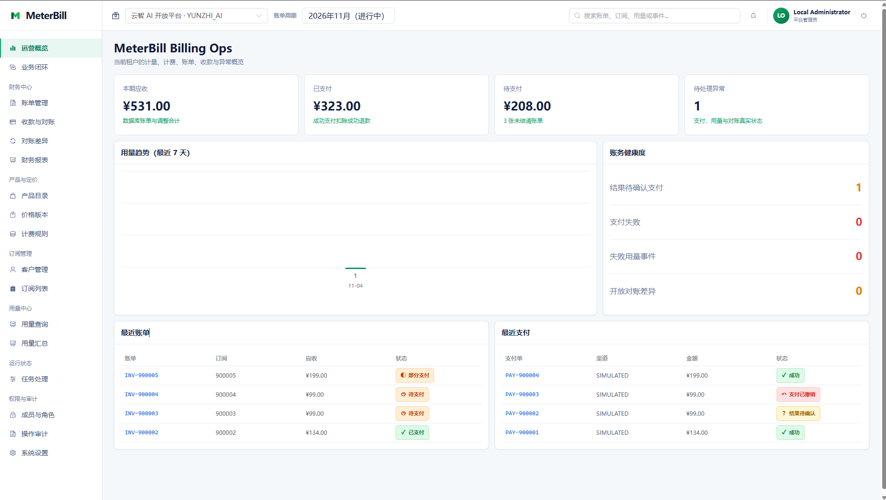
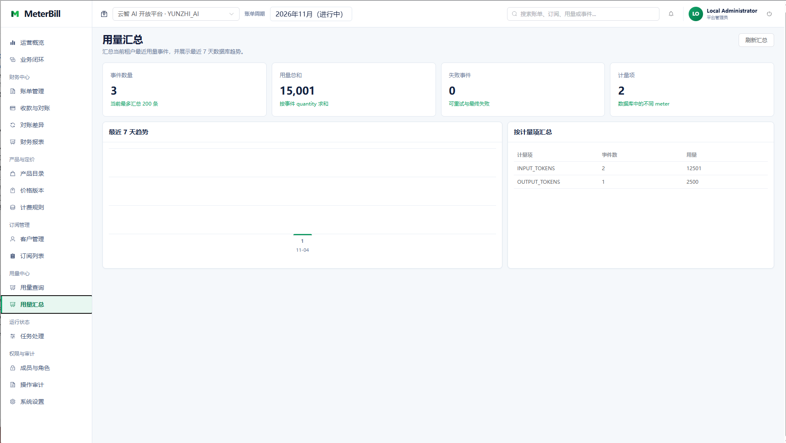
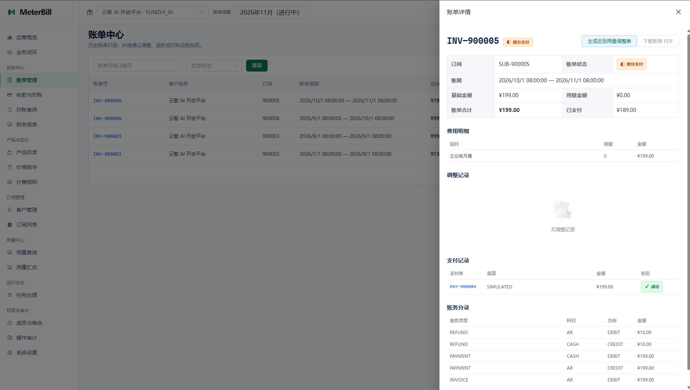
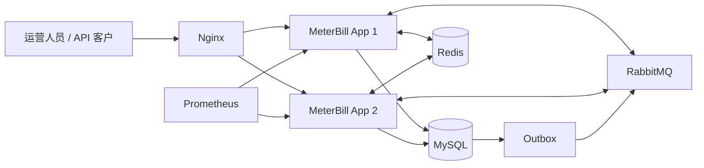

# MeterBill

MeterBill 是一个面向 AI API SaaS 的多租户计量、计费与账务平台。它把“套餐配置 → 客户订阅 → Token 用量上报 → 异步聚合 → 月度出账 → 模拟支付/退款 → 复式记账 → 对账恢复”串成一条可验证的业务闭环，并提供管理控制台、监控告警与双实例部署方案。

## 核心能力

- **多租户与权限**：JWT、RBAC、API Key、租户上下文隔离和安全审计。
- **产品与定价**：AI 模型、输入/输出 Token 计量项、套餐额度、阶梯计价和不可变价格版本。
- **订阅生命周期**：开通、续订、到期、周期末取消和下周期套餐变更。
- **可靠计量**：用量事件幂等接收，数据库与 Outbox 同事务提交，RabbitMQ 异步投递和消费者去重聚合。
- **计费与账单**：按自然月和租户时区确定账期，使用 `BigDecimal` 完成确定性计价，支持迟到用量调整且不覆盖历史账单。
- **账务与支付**：应收、模拟支付、退款、整笔支付撤销和简化复式记账；所有已入账交易保持借贷平衡。
- **对账与恢复**：核对账单、账本和模拟渠道流水，持久化差异并支持失败任务恢复。

## 业务界面

### 运营概览

运营看板汇总本期应收、已支付、待支付、异常任务、近期账单与支付状态，帮助运营人员快速掌握租户的计量和收款情况。



### 用量汇总

用量中心按事件和计量项汇总 Token 消耗，展示事件数量、累计用量、失败事件及不同计量项的业务数据。



### 账单、支付与账务分录

账单详情保留费用项目、支付记录和复式记账分录，可从一张账单追踪应收、支付、退款及调整过程。



## 系统结构




## 技术栈

| 领域 | 技术 |
| --- | --- |
| 后端 | Java 21、Spring Boot 4.1、Spring Security、MyBatis-Plus、Flyway |
| 数据与消息 | MySQL 8.4、Redis 7.4、Redisson、RabbitMQ 4.1 |
| 前端 | Vue 3、TypeScript、Vite、Pinia、Element Plus |
| 测试 | JUnit 5、MockMvc、Testcontainers、JMeter |
| 可观测性 | Actuator、Micrometer、Prometheus |
| 部署 | Docker、Docker Compose、Nginx、GitHub Actions |

## 快速启动

推荐使用部署 Compose 一次启动完整环境。需要 Docker Desktop/Engine、Docker Compose v2，以及至少 4 GiB 可用内存。

```powershell
Copy-Item deploy/.env.example deploy/.env
# 编辑 deploy/.env，替换全部 replace_with_* 配置

docker compose -p meterbill --env-file deploy/.env -f deploy/compose.yaml build
docker compose -p meterbill --env-file deploy/.env -f deploy/compose.yaml up -d
docker compose -p meterbill --env-file deploy/.env -f deploy/compose.yaml ps
```

首次运行如需创建演示管理员，可在 `deploy/.env` 中临时设置：

```dotenv
SPRING_PROFILES_ACTIVE=local
METERBILL_BOOTSTRAP_ENABLED=true
METERBILL_BOOTSTRAP_TENANT_CODE=demo
METERBILL_BOOTSTRAP_EMAIL=admin@example.com
METERBILL_BOOTSTRAP_PASSWORD=请替换为至少12位的强密码
```

